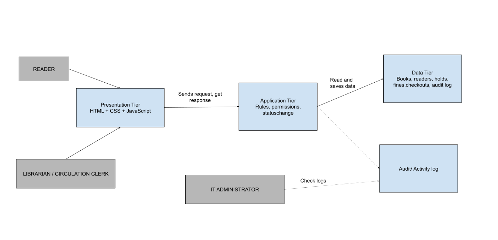

# ShelfLife — Three-Tier Architecture

**Presentation Tier**

Purpose: Interact with customers (READER)

Responsibilities

- Shows the checkout form (Reader ID, barcode/ISBN, checkout date, optional notes)

- Collects what the user types, with clear labels that work with a keyboard (NFR-1)

- Gives quick feedback if a field is empty or wrong

- Shows the due date and a success or rejection message

- Shows the exact reason for a rejection: fines too high, book not available, book on hold, item limit reached, or bad barcode (FR-12, NFR-2)

- Shows the override button only to clerks who are allowed to use it

- Works well on desk computers and staff screens (NFR-4)

Not authoritative for

- Whether a checkout is allowed

- Whether the book is available, on hold, or has fines or limits problems

- How the due date is calculated

- The official status of the book or checkout

- The official checkout ID

- The official time of the transaction

- Saving data permanently

**Application Tier**

Purpose: make final, trusted decisions about a transaction

Future responsibilities

- Checks that the barcode/ISBN matches a real book (BR-7, FR-3) (Validation)

- Apply business rules

- Blocks checkout reference-only and reserve items

- Calculate due date

- Stop double checkout

- Checks permissions

- Create official transaction ID (checkout ID)

- Checks status changes are allowing

- Records trusted times and audit logs for every checkout

- Read and save data

- Send back feedback

**Data Tier**

Purpose: keep the official record, allows the transaction to be traceable

Future responsibilities

- Store:

  - Checkout ID (transaction ID)

  - Checkout details ( Reader ID, book ID, checkout date, due date, notes)

  - Official status

  - Reader’s fine balance and number of check-out item

  - Hold records

  - Timestamps

  - Audit history (staff ID and override history)
