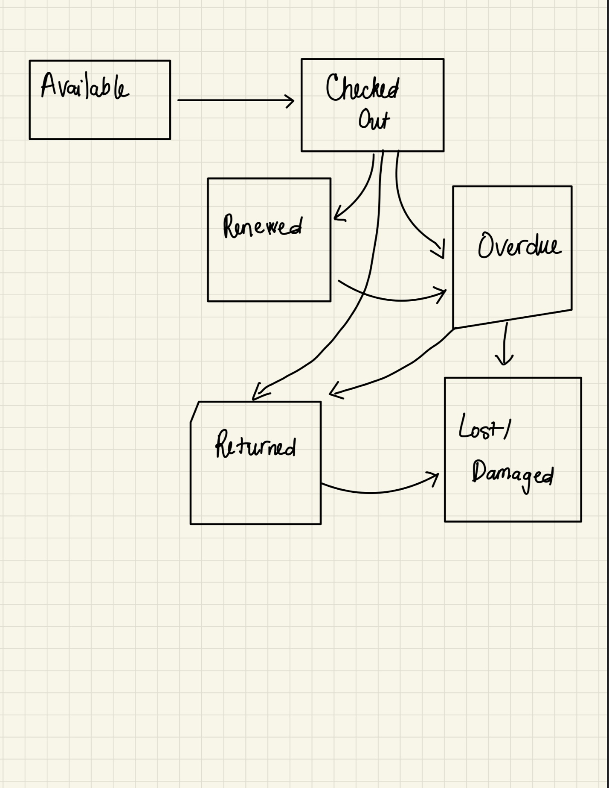

# ShelfLife — State Transition Diagram and State Definitions

# 1. State transition diagram

# 2. State definitions

| **State**      | **Definition**                                                                                                                  |
|----------------|---------------------------------------------------------------------------------------------------------------------------------|
| Draft | The reader or librarian is filling out the checkout form. The request has not been submitted yet. |
| Submitted | The checkout request has been submitted and is being checked against the library's business rules. |
| Completed | The checkout request passed all required validations and was approved. Once officially recorded, the book's status changes to Checked Out. |
| Rejected | The checkout request failed one or more validations or business rules. The system provides a reason for rejection. |

# 3. Key transitions

- Start → Draft: The reader or librarian begins a checkout request.
- Draft → Submitted: The checkout form is submitted.
- Submitted → Completed: All required validations and business rules pass.
- Submitted → Rejected: One or more validations or business rules fail.
- Completed → End: The checkout transaction is finished successfully.
- Rejected → Draft: The reader corrects the issue and begins a new checkout attempt.
