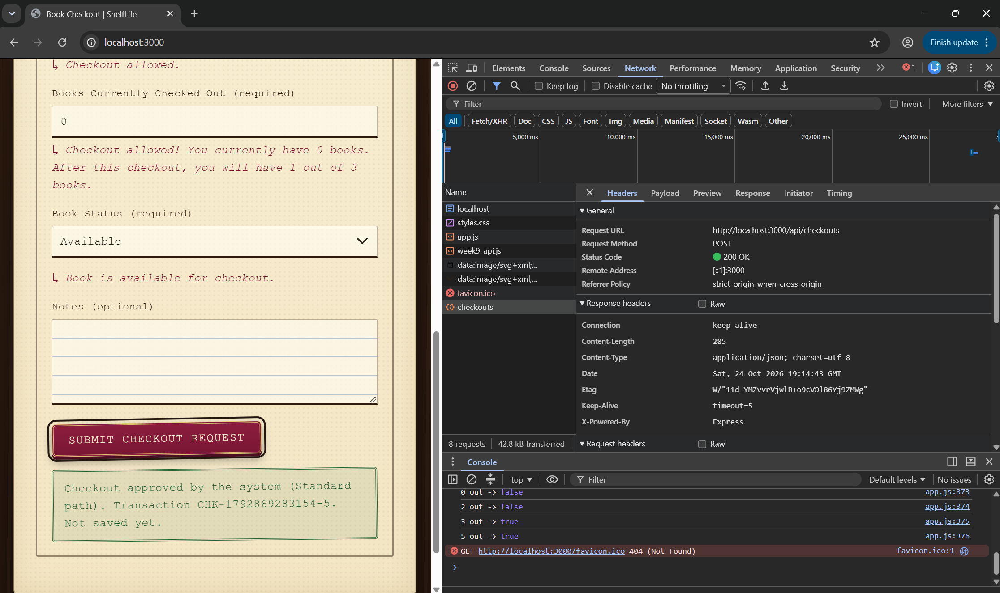
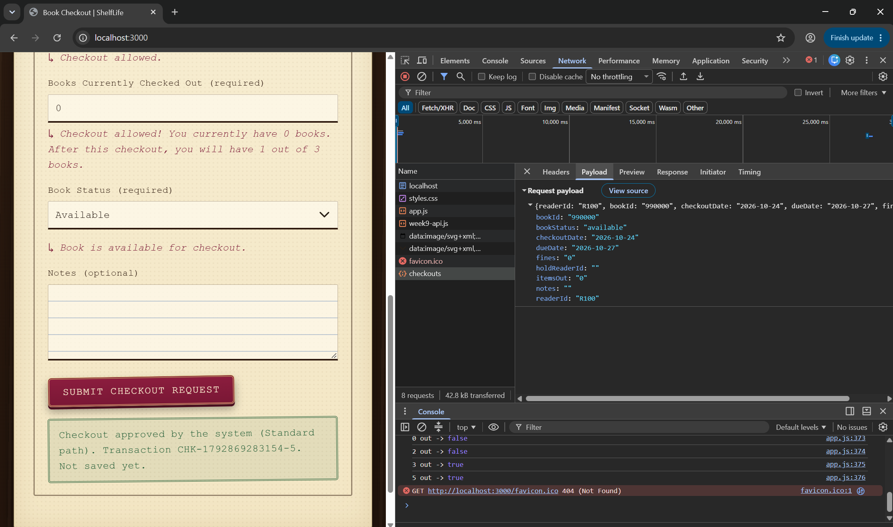
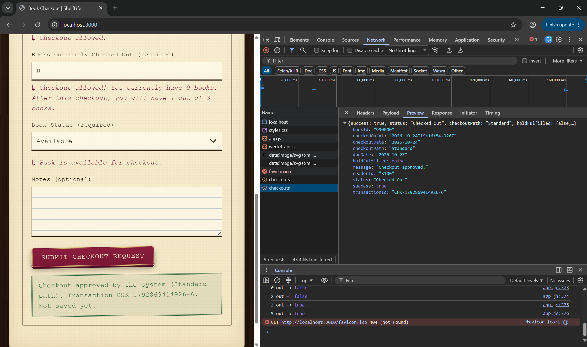
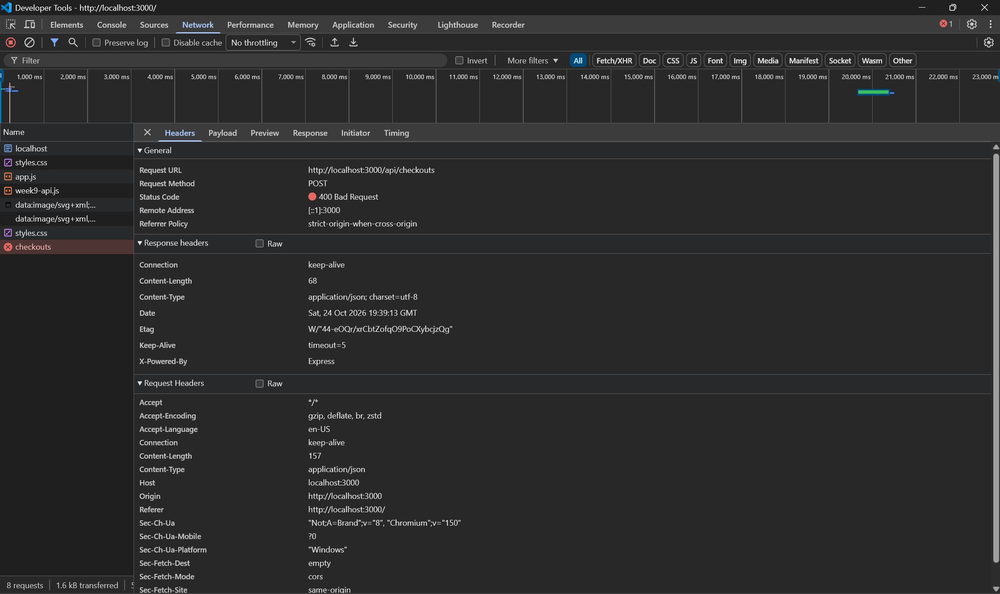
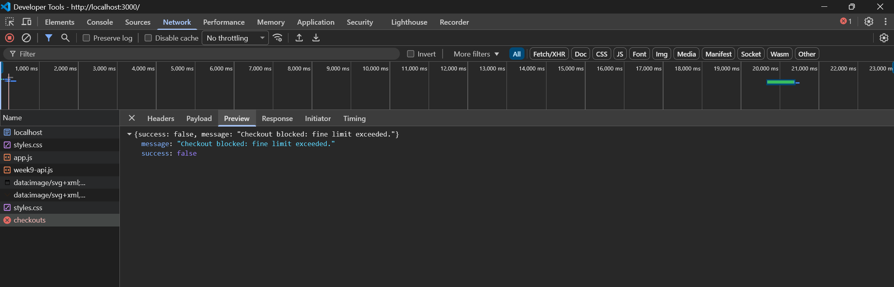
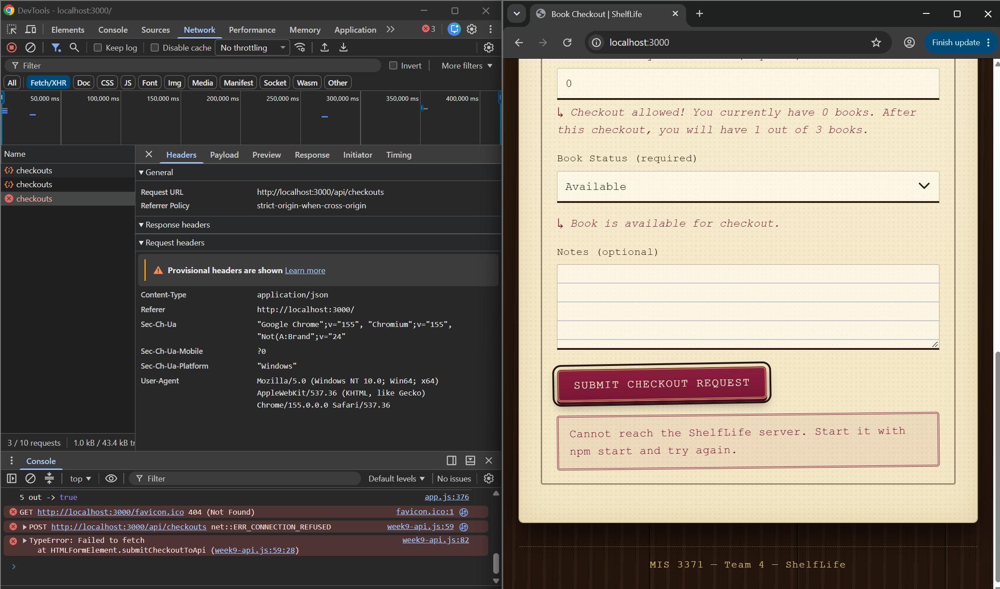

# Week 9 — Local API: Connect the Form to the Backend

The checkout form now sends each checkout to a local Express server, which passes it to the same Week 8 `processCheckout()` function and sends the decision back. No AWS, no database: **nothing is saved yet**.

## The path of one checkout

```text
Browser form fields
   -> checkout object                      (src/week9-api.js: buildCheckout)
   -> JSON.stringify -> POST /api/checkouts
   -> Express parses JSON into req.body    (server/server.js: express.json)
   -> processCheckout(req.body)            (backend/backend.js, unchanged Week 8 rules)
   -> 200 or 400 + JSON result
   -> response.json()
   -> message on the page: approved / rejected / cannot reach the server
```

The server only moves data. All business rules stay in `backend/backend.js`, so the browser, the test files, and next week's AWS Lambda all use the same rules.

## Files

| File | Week | What it does |
|---|---|---|
| `server/server.js` | 9 (new) | Serves the page from `src/` and the `POST /api/checkouts` endpoint |
| `server/test-api.js` | 9 (new) | 8 HTTP tests against the running server |
| `src/week9-api.js` | 9 (new) | Replaces the Week 7 demo submit handler with one that calls the API with `fetch()` |
| `src/transaction-form.html` | 4–7 | One added line: loads `week9-api.js` after `app.js` |
| `src/styles.css` | 5 | One added rule: green stamp for an approved checkout |
| `src/app.js` | 6–7 | Unchanged: live messages and browser rule checks still run |
| `backend/backend.js` | 8 | Unchanged by Week 9 |
| `package.json` | 9 (new) | Express dependency and the `start`, `test:backend`, `test:api` commands |

## How to run

You need Node.js (v18 or newer). From the repository root:

```bash
npm install          # first time only: installs Express into node_modules/
npm start            # starts http://localhost:3000 — leave this terminal open
```

Open **http://localhost:3000** in Chrome. Do not open the HTML file directly (`file://`) or use Live Server, because the API only exists on the Express server.

To run the tests, open a **second** terminal while the server is running:

```bash
npm run test:api       # 8 HTTP tests against the server
npm run test:backend   # 15 Week 8 tests (no server needed)
```

Stop the server with **Ctrl + C**. After editing `server/` or `backend/` files, stop and restart it. After editing `src/` files, just refresh the browser.

## The endpoint

| | |
|---|---|
| Method and path | `POST /api/checkouts` |
| Request header | `Content-Type: application/json` |
| Request body | `readerId`, `bookId`, `checkoutDate`, `dueDate`, `fines`, `itemsOut`, `bookStatus`, `holdReaderId`, `notes` |
| `200` response | Checkout accepted: `{ success: true, checkoutPath, transactionId, checkedOutAt, ... }` |
| `400` response | Checkout rejected by a rule: `{ success: false, message }` |

The HTTP status says whether the request was accepted; the JSON body explains the transaction result.

## Three outcomes the page shows

| Outcome | When | Message on the page |
|---|---|---|
| Approved (green stamp) | Server returns 200 | "Checkout approved by the system (Standard path). Transaction CHK-…. Not saved yet." |
| Rejected (red stamp) | Server returns 400 | "Checkout rejected by the system: " + the backend's reason |
| Connection error (red stamp) | `fetch()` fails because the server is stopped | "Cannot reach the ShelfLife server. Start it with npm start and try again." |

The browser still runs the Week 7 checks first. When one fails, the page shows the browser message and **no request is sent**. The backend checks everything again, so a request that skips the form is still rejected.

## Test results

### API tests (`npm run test:api`)

Every test starts from the same clean checkout: Reader `R100`, Book `B1234`, checkout `2026-10-01`, due `2026-10-04`, fines `0`, books out `0`, status `available`, no hold.

| # | Test | Type | Expected | Actual | Result |
|---|---|---|---|---|---|
| 1 | Clean checkout | Valid | 200, Standard | 200, Standard | PASS |
| 2 | Reader picks up own hold | Valid | 200, Hold pickup | 200, Hold pickup | PASS |
| 3 | Fines $10.00 exactly | Boundary | 200, Standard | 200, Standard | PASS |
| 4 | Fines $10.01 | Boundary | 400, "Checkout blocked: fine limit exceeded." | 400, same | PASS |
| 5 | Due 6 days after checkout | Boundary | 400, "Due date must be 1 to 5 calendar days after the checkout date." | 400, same | PASS |
| 6 | Book on hold for another reader | Invalid | 400, "Checkout blocked: this book is on hold for another reader." | 400, same | PASS |
| 7 | 3 books already out | Boundary | 400, "Checkout blocked: checkout limit of 3 books reached." | 400, same | PASS |
| 8 | Reader ID missing | Invalid | 400, "Reader ID is required." | 400, same | PASS |

**8 of 8 passed.**

### End-to-end tests through the real form

Run in Chrome at http://localhost:3000 with DevTools open on the **Network** tab.

| # | What was entered | Expected | Actual | Result |
|---|---|---|---|---|
| 1 | Clean checkout | 1 request, 200; green "approved (Standard path)" | 1 request, 200; green "Checkout approved by the system (Standard path)… Not saved yet." | PASS |
| 2 | On Hold, hold placed by `R100` | 1 request, 200; "approved (Hold pickup path)" | 1 request, 200; "Checkout approved by the system (Hold pickup path)…" | PASS |
| 3 | Fines `10.00` | 1 request, 200; approved | 1 request, 200; approved | PASS |
| 4 | Fines `10.01` | Browser blocks; no request | No request; "Checkout blocked: fines are over the $10.00 limit. Pay your fines first." | PASS |
| 5 | Books out `2` | 1 request, 200; approved | 1 request, 200; approved | PASS |
| 6 | Books out `3` | Browser blocks; no request | No request; "Checkout not allowed! You can only check out up to 3 books." | PASS |
| 7 | Due date +6 days | Browser blocks; no request | No request; "Checkout blocked: the due date must be 1 to 5 calendar days after the checkout date." | PASS |
| 8 | On Hold, hold placed by `R200` | Browser blocks; no request | No request; "Checkout blocked: this book is on hold for another reader. Choose a different book." | PASS |
| 9 | Server stopped, then submit | Request fails; connection message | `net::ERR_CONNECTION_REFUSED`; "Cannot reach the ShelfLife server. Start it with npm start and try again." | PASS |

### The backend still protects the transaction without the form

The same rules were sent straight to the API with `fetch()` from the DevTools Console, skipping every browser check:

| Request | Expected | Actual | Result |
|---|---|---|---|
| Fines `10.01` | 400 | 400, "Checkout blocked: fine limit exceeded." | PASS |
| Books out `3` | 400 | 400, "Checkout blocked: checkout limit of 3 books reached." | PASS |
| Due +6 days | 400 | 400, "Due date must be 1 to 5 calendar days after the checkout date." | PASS |
| Book status `lost` | 400 | 400, "Checkout blocked: book is not available." | PASS |

Also checked: no Console errors, the live field messages from `app.js` still update, the Week 7 demo message never appears, and the page has no sideways scrolling at 375px.

## Network evidence

In DevTools → **Network**, click the `checkouts` request after a clean checkout:

| Network tab | Value seen |
|---|---|
| Method + URL | `POST /api/checkouts` |
| Status | `200 OK` |
| Payload | `{"readerId":"R100","bookId":"B1234","checkoutDate":"2026-10-01","dueDate":"2026-10-04","fines":"0","itemsOut":"0","bookStatus":"available","holdReaderId":"","notes":""}` |
| Response | `{"success":true,"status":"Checked Out","checkoutPath":"Standard","holdFulfilled":false,"readerId":"R100","bookId":"B1234","checkoutDate":"2026-10-01","dueDate":"2026-10-04","transactionId":"CHK-…","checkedOutAt":"…","message":"Checkout approved."}` |

**Approved checkout: 200**







**Rejected checkout sent straight to the API: 400**





**Server stopped: connection error**



## Troubleshooting

| Problem | Meaning | Fix |
|---|---|---|
| "This site can't be reached" | The server is not running | Run `npm start` and keep that terminal open |
| "Cannot find module 'express'" | Express is not installed | Run `npm install` from the repository root |
| `EADDRINUSE :3000` | A server is already running | Close the other terminal or press Ctrl + C there |
| 404 on `/api/checkouts` | Wrong method or path | The form must `POST` to `/api/checkouts` |
| Page has no styles | Page opened as `file://` | Open http://localhost:3000 instead |
| "Client-side checks passed…" appears | The Week 7 demo handler is still active | Make sure `week9-api.js` loads after `app.js` |